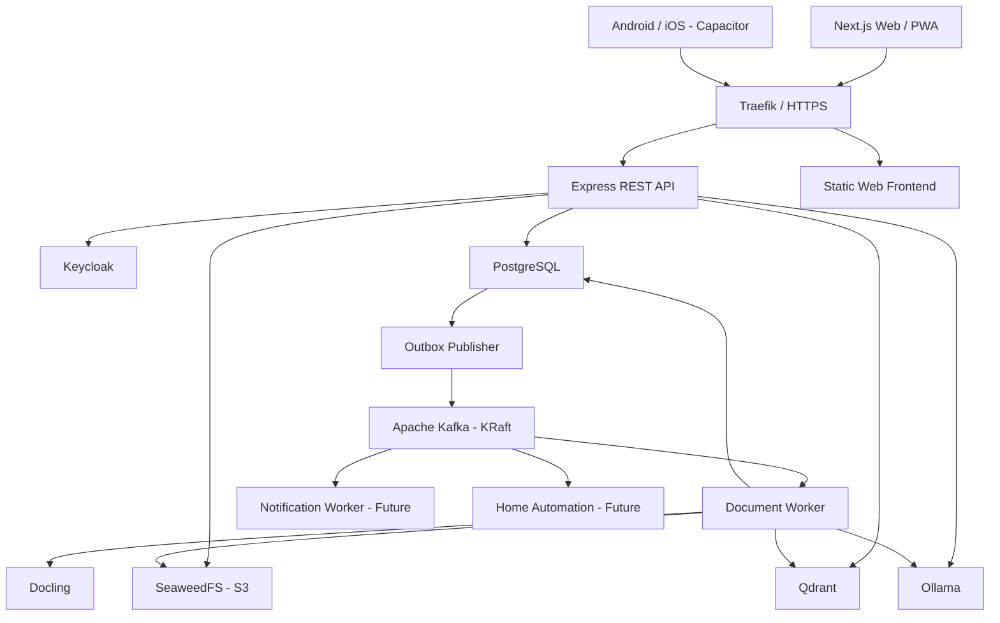
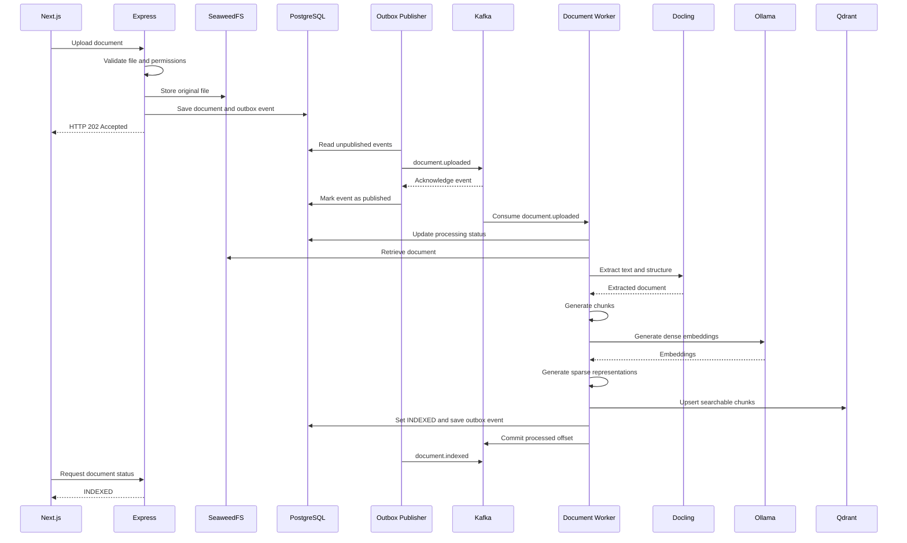
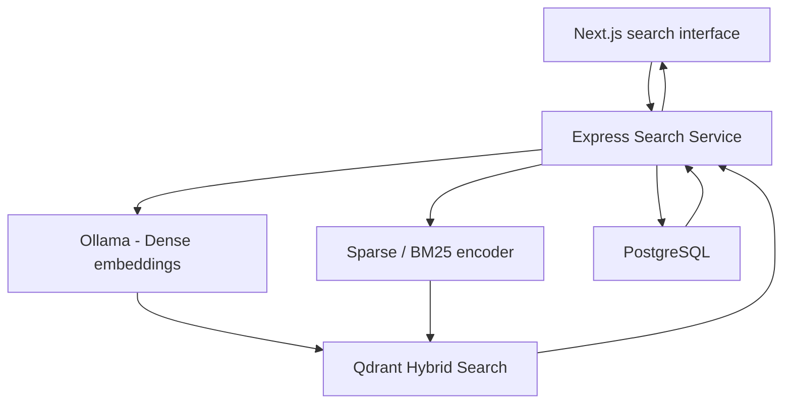
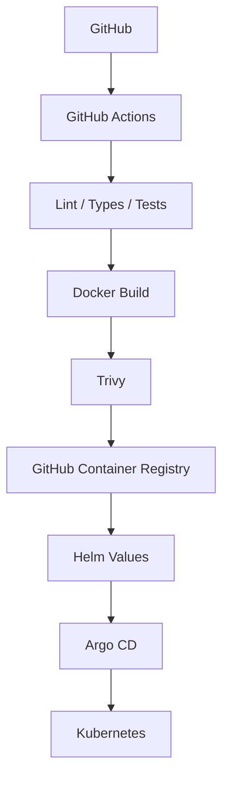

# IA-Casa — Software Architecture

## 1. Project vision

IA-Casa is a self-hosted home management platform accessible from:

- Desktop browsers.
- Android devices.
- iOS devices.
- Progressive Web App.

The platform will progressively support:

- Document management.
- Semantic and lexical document search.
- AI assistant based on private documents.
- Household expenses.
- Bills and energy consumption.
- Mortgage management.
- Maintenance management.
- Deadlines and notifications.
- Home automation and Home Assistant integration.

All sensitive data and AI processing must remain on local infrastructure.

## 2. Architectural style

The architecture combines:

- Modular monolith.
- Event-Driven Architecture.
- Producer-Consumer Pattern.
- Polyglot Persistence.
- Independent asynchronous workers.
- Container-based deployment.

The main backend is a modular Express.js application.

Heavy document-processing operations are delegated to independent workers through Apache Kafka.

The project must not be decomposed into unnecessary microservices during its initial phases.

## 3. High-level architecture



## 4. Frontend architecture

The frontend uses:

- Next.js with App Router.
- React.
- TypeScript.
- Tailwind CSS.
- shadcn/ui.
- TanStack Query.
- Zustand.
- React Hook Form.
- Zod.

Express is responsible for backend business logic.

The frontend must not depend on Next.js Server Actions or dynamic server-side rendering for essential functionality.

Next.js static export will be used to support Capacitor.

The frontend must communicate with the backend through configurable REST API endpoints.

The mobile application will reuse the web frontend through Capacitor.

## 5. Backend architecture

The backend uses Express.js and TypeScript.

It is organized into independent functional modules.

Initial modules:

- Authentication.
- Users.
- Documents.
- Search.
- Health checks.

Future modules:

- Expenses.
- Bills.
- Mortgage.
- Maintenance.
- Deadlines.
- Notifications.
- Energy.
- Home automation.
- AI assistant.

Each module may contain:

- Controllers.
- Services.
- Repositories.
- Validation schemas.
- Routes.
- Domain types.

Controllers handle HTTP requests.

Services implement business logic.

Repositories handle database access.

## 6. Persistence architecture

### PostgreSQL

PostgreSQL is the authoritative source of application data.

It stores:

- User information and external identity references.
- Document metadata.
- Document processing status.
- Categories and tags.
- Expenses.
- Maintenance records.
- Bills.
- Application configuration.
- Outbox events.
- Consumer processing records.

Use Drizzle ORM and versioned database migrations.

### Qdrant

Qdrant is the dedicated document search engine.

It stores:

- Dense embeddings.
- Sparse vectors for lexical search.
- Document chunks.
- Document identifiers.
- Page references.
- Search metadata.
- Embedding model information.

Qdrant is a derived index that must be rebuildable from original documents and application data.

### SeaweedFS

SeaweedFS provides local S3-compatible object storage.

It stores:

- Original PDF documents.
- Word documents.
- Excel documents.
- Images.
- Scanned documents.
- Other supported attachments.

Binary documents must not be stored directly in Kafka or Qdrant.

## 7. Apache Kafka

Kafka is the central event streaming infrastructure.

Use Kafka in KRaft mode without ZooKeeper.

Start with a single broker for local development.

A single-broker configuration is not highly available.

Initial topics:

| Topic | Purpose |
|---|---|
| document.uploaded | A new document has been stored |
| document.indexed | Document indexing completed |
| document.deleted | Document deletion requested by application state change |
| document.failed | Document processing failed |
| document.retry | Document processing retry |
| document.dlq | Permanently failed processing events |

Future topics:

- bill.received
- payment.completed
- maintenance.due
- notification.requested
- energy.consumption
- sensor.temperature
- sensor.humidity
- device.state.changed

Use document identifiers as Kafka message keys where document-level ordering is required.

Every event should contain:

- eventId
- eventType
- eventVersion
- occurredAt
- correlationId
- payload

Event schemas must be versioned and validated.

## 8. Transactional Outbox Pattern

When the API creates or updates a document, PostgreSQL must persist the application state and its corresponding outbox event in the same transaction.

The Outbox Publisher reads unpublished events from PostgreSQL and publishes them to Kafka.

Events are marked as published after broker acknowledgment.

This pattern reduces the risk of losing domain events when Kafka is temporarily unavailable.

Consumers must remain idempotent because duplicate events are possible.

Object storage operations are outside the PostgreSQL transaction and require reconciliation or compensating operations.

## 9. Document upload workflow



Document processing must happen asynchronously.

The HTTP request must not remain open while OCR, embeddings or indexing are executed.

## 10. Document lifecycle

Document statuses:

- PENDING
- EXTRACTING
- CHUNKING
- EMBEDDING
- INDEXING
- INDEXED
- FAILED
- DELETING
- DELETED

PostgreSQL stores the current application-level processing status.

Workers must support:

- Idempotent processing.
- Retry with backoff.
- Duplicate event handling.
- Recovery from partial failures.
- Deterministic Qdrant point identifiers.
- Safe reindexing.
- Safe document deletion.
- Kafka heartbeat and offset management during long-running jobs.

## 11. Document search workflow

Search requests are synchronous and do not require Kafka.



Support:

- Keyword search.
- Semantic search.
- Hybrid search.
- Metadata filters.
- Exact identifier search.
- Document categories and tags.
- Page-level search results.

Dense and sparse search results can be combined using Reciprocal Rank Fusion.

Authorization filters must be applied during search, and access permissions must be verified before returning results.

## 12. Local artificial intelligence

Use Ollama as the local AI runtime.

Use BGE-M3 for multilingual dense embeddings.

A separate compatible sparse encoder must be selected for BM25 or sparse retrieval.

Docling handles:

- Document parsing.
- OCR.
- Table extraction.
- Structural information.

Chunking should respect document structure and page information.

Start with approximately 512-token chunks and adjust after evaluating search quality.

Future AI assistant:

- Retrieval Augmented Generation (RAG).
- Local LLM.
- Answers grounded in retrieved documents.
- Citations to original documents and pages.

## 13. Authentication

Use Keycloak with OpenID Connect.

Use Authorization Code Flow with PKCE for public frontend and mobile clients.

Express must validate access tokens and enforce application-level authorization.

Do not rely only on frontend access controls.

## 14. Repository structure

```text
ia-casa/
├── AGENTS.md
├── docs/
├── apps/
│   ├── frontend/
│   └── backend/
├── workers/
│   ├── document-worker/
│   ├── outbox-publisher/
│   └── notification-worker/
├── services/
│   └── document-parser/
├── packages/
│   ├── database/
│   ├── events/
│   ├── kafka/
│   ├── types/
│   ├── validation/
│   └── ui/
├── infrastructure/
│   ├── docker/
│   ├── helm/
│   │   ├── frontend/
│   │   ├── backend/
│   │   ├── document-worker/
│   │   ├── outbox-publisher/
│   │   └── document-parser/
│   ├── kafka/
│   └── argocd/
├── .github/
│   └── workflows/
├── compose.yaml
├── package.json
├── pnpm-workspace.yaml
├── pnpm-lock.yaml
└── turbo.json
```

This is the target structure. Directories must be created progressively as required.

pnpm discovers packages under `apps/*`, `workers/*`, `services/*`, and `packages/*`.
Packages can declare local dependencies with `workspace:*`. Turborepo uses
those dependencies and `turbo.json` to schedule package scripts and cache
build outputs. TypeScript projects extend the root `tsconfig.base.json` and
set compiler options specific to their runtime in their own configurations.

## 15. Deployment architecture

### Development

- Windows.
- WSL2.
- VS Code.
- Docker Desktop.
- Docker Compose.
- Development workspace container.

The workspace image builds from `infrastructure/docker/`. Compose mounts the
repository at `/workspace` at runtime and uses the configured local UID and
GID for processes that write to it.

### Production

- Linux server.
- Kubernetes using K3s.
- Helm.
- Strimzi.
- Traefik.
- Argo CD.
- Persistent volumes.

Each custom application must support:

- Independent Docker image.
- Independent image version.
- Independent Kubernetes Deployment.
- Independent Helm release.
- Independent update and rollback.

Third-party infrastructure components may use official or maintained Helm charts and operators.

## 16. CI/CD



Each independently deployable application should have an independent pipeline or equivalent affected-project build strategy.

Shared package modifications must trigger the pipelines of affected applications.

Use immutable or uniquely versioned image tags.

## 17. Observability

Future monitoring stack:

- Prometheus.
- Grafana.
- Loki.
- Pino.
- Kafbat UI.

Monitor:

- HTTP latency.
- API errors.
- Kafka consumer lag.
- Failed document processing.
- Worker health.
- Database availability.
- Storage utilization.
- CPU and memory consumption.

## 18. Security and backups

- Keep private data on local infrastructure.
- Use HTTPS.
- Use private network access or VPN for remote access.
- Do not expose internal databases.
- Encrypt backups.
- Back up PostgreSQL and original documents.
- Back up or rebuild Qdrant as appropriate.
- Test backup restoration.
- Keep credentials outside source control.

## 19. Architecture evolution

Start with a modular backend and a limited number of asynchronous workers.

Introduce additional independent services only when there is a clear functional, operational or scaling requirement.

Kafka will progressively support document management, notifications, energy monitoring and home automation.
